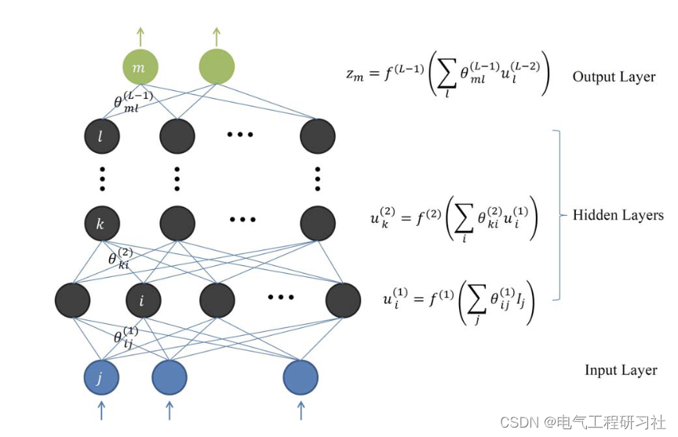
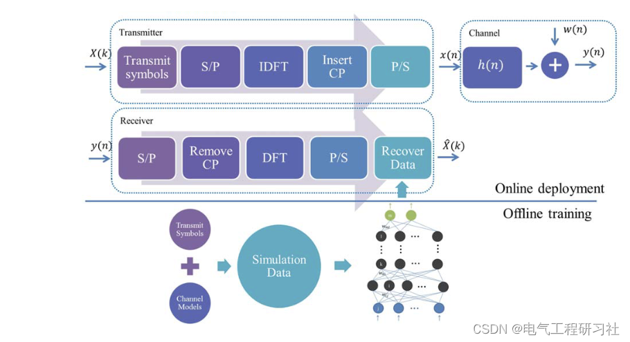
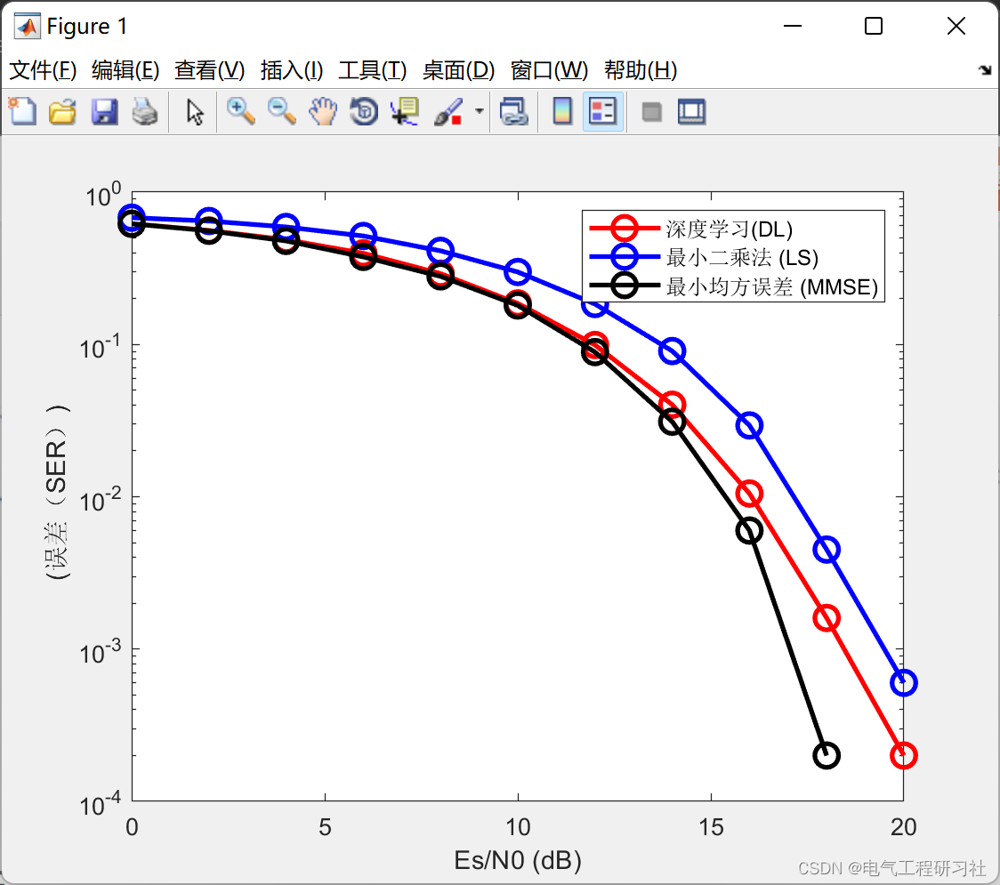

# [Signal Detection]Long Short-Term Memory (LSTM) Based Deep Learning Signal Detection in OFDM System (Matlab Code Implementation)

1. Overview of Orthogonal Frequency Division Multiplexing (OFDM)
OFDM is a popular modulation scheme that has been widely adopted in wireless broadband systems to combat frequency-selective fading in wireless channels. Channel State Information (CSI) is crucial for coherent detection and decoding in OFDM systems. Typically, CSI can be estimated before detecting the transmitted data through pilots. Using the estimated CSI, symbols transmitted can be recovered at the receiver. Historically, channel estimation in OFDM systems has been thoroughly studied. Traditional estimation methods such as Least Squares (LS) and Minimum Mean Square Error (MMSE) have been utilized and optimized under various conditions [2]. The LS method does not require prior channel statistics but may have suboptimal performance. MMSE estimation typically achieves better detection performance by leveraging the second order statistics of the channel.
This is an example of symbol classification at the receiver using a Long Short-Term Memory (LSTM) network in the context of OFDM system signal detection, utilizing deep learning toolskit. The neural network based on LSTM is trained for individual subcarriers, where the Signal Error Rate (SER) is calculated and compared with the least squares (LS) and minimum mean square error (MMSE) estimates. In this initial investigation, it is assumed that the wireless channel remains constant during offline training and online deployment phases. To test the robustness of the neural network, random phase shifts are applied to each OFDM data packet. The effects of trial symbol count and cyclic prefix (CP) length are considered. This paper presents preliminary results of deep learning for channel estimation and signal detection in the OFDM system. In this letter, we leverage deep learning to process the wireless OFDM channel end-to-end. Unlike existing OFDM receivers which first explicitly estimate channel state information (CSI) and then use the estimated CSI to detect/recover transmitted symbols, the proposed deep learning-based method implicitly estimates CSI and directly recovers transmitted symbols. To address channel distortion issues, the deep learning model is first trained offline using data generated by channel statistical simulations, and then directly used to recover online transmitted data. According to our simulation results, the deep learning-based method can resolve channel distortion issues and detect transmitted symbols, achieving performance comparable to the minimum mean square error estimator. Moreover, when using fewer training pilots, omitting the cyclic prefix and presence of nonlinear clipping noise, the deep learning-based method is more reliable than traditional methods. In summary, deep learning is a promising tool for channel estimation and signal detection in wireless communications, facing complex channel distortion and interference.
2. Estimation and Detection Based on Deep Learning
2.1 Deep Learning Methodology
2.2 Model Training
The rest of the detailed parts are shown in Section 4.
2. Simulation Results
3 Matlab Code and Article Explanation
This article only showcases part of the code, all codes are available in:

## Images

<!-- PAYMENT_BLOCK -->

## Get this dataset

- Payment link (Stripe): [Buy now](https://buy.stripe.com/3cs8yP7sY87d0vu9AB)
- Payment QR code: 

<!-- /PAYMENT_BLOCK -->
